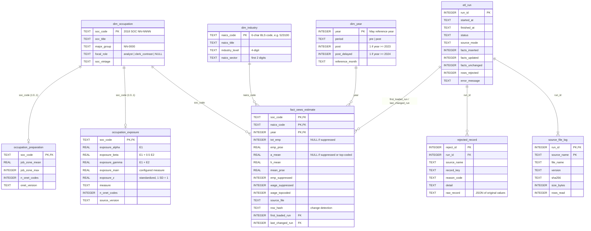

# Entity-Relationship Diagram

Star schema at the **detailed occupation × 4-digit industry × May reference year** grain, plus audit tables for lineage. GitHub renders the Mermaid block below; field-level definitions are in [DATA_DICTIONARY.md](DATA_DICTIONARY.md).

## Design decisions

**Why this grain.** The A3 specification, log(Y_oit) = α_oi + δ_it + β(Exposure_o × Post_t) + ε, needs one observation per occupation *o*, industry *i*, and year *t*. The composite primary key `(soc_code, naics_code, year)` enforces exactly that, so a duplicate cell cannot enter the estimation sample.

**Normalization (3NF).**
- OEWS repeats the occupation title and industry title on every row. Those depend only on `soc_code` or `naics_code`, so they live in `dim_occupation` and `dim_industry`; the fact table holds only measures that depend on the full key.
- Exposure and Job Zone scores depend only on the occupation, not on industry or year, so they are separate occupation-level tables. They are kept apart from `dim_occupation` because they come from different sources with different versions, and some occupations lack a score (1 : 0..1).
- Period flags depend only on the year, so `post` and `post_delayed` sit in `dim_year`. Changing the treatment timing is a one-row edit, not a fact-table rewrite.

**Suppression is data, not error.** BLS symbols (`**`, `*`, `#`) become NULL plus a flag. Rows are kept so coverage and selection into suppression can be reported, and the estimation step decides its own sample.

**Lineage.** Every fact records the run that first loaded it and the run that last changed it. Every run logs each file's SHA-256 and row count. Every rejected row is stored with its raw values. Any number in a later table can be traced back to a file and a run.

**Analysis view.** `v_analysis_panel` joins the star schema into the modeling frame and adds `exposure_x_post`, `emp_model_ready`, and `wage_model_ready`. Assignment 5 reads this view instead of re-deriving joins.

## Indexing strategy

The database is small (one row per occupation × industry × year, about 100k–200k facts on real data). It is refreshed in batches and read mostly by panel queries. Indexes therefore target the three access patterns that matter and nothing more, because every extra index slows each upsert.

| Index | Columns | Serves |
|---|---|---|
| PK (automatic) `fact_oews_estimate` | `(soc_code, naics_code, year)` | Upsert conflict detection on every load; occupation lookups (left-most column); uniqueness of the panel cell |
| `ix_fact_year_naics` | `(year, naics_code)` | Industry-by-year slices: the δ_it fixed effects, per-year coverage and quality-report queries |
| `ix_fact_naics_soc` | `(naics_code, soc_code)` | Occupation-by-industry cells across years: the α_oi fixed effects and the balanced-cell check |
| `ix_reject_run` | `(run_id, reason_code)` | Per-run reject summaries in the quality report |
| PK on each dimension | `soc_code`, `naics_code`, `year` | All joins in `v_analysis_panel` |

Low-cardinality flags (`post`, `emp_suppressed`) are not indexed. They split rows roughly in half or less, so SQLite's planner would scan the table anyway. To verify plans, run `EXPLAIN QUERY PLAN` against `v_analysis_panel`.
