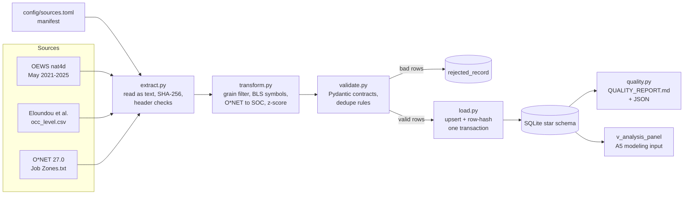

# Data Pipeline: GenAI Exposure and Financial Analyst Employment and Wages

BUS 751, Assignment 4 (Database Design & Data Pipeline). Pathway 2 (research-oriented).
This pipeline builds the analysis database for the A3 design: OEWS occupation × industry × year outcomes, merged with Eloundou et al. (2024) GenAI exposure and pre-period O*NET Job Zones.

## One command

```powershell
uv sync                         # once: creates .venv from pyproject.toml / uv.lock
uv run oews-pipeline run        # build or refresh data/processed/oews_genai.db (synthetic sample)
uv run oews-pipeline run --source raw   # same, using real files in data/raw/ (see DATA_ACCESS.md)
```

Other commands:

| Command | Purpose |
|---|---|
| `uv run oews-pipeline rerun-check` | Fresh DB, two runs, writes `docs/RERUN_CHECK.md`; exits 1 on any failed check |
| `uv run oews-pipeline make-sample` | Rebuilds `data/sample/` from the seeded generator |
| `uv run pytest -q` | 8 tests: parsing rules, rejects, idempotency, refresh, failure handling |
| `uv run python -m oews_pipeline run` | Same as `oews-pipeline run`, without the console script |

## Sources in scope for A4

| A3 source | A4 status |
|---|---|
| OEWS national industry-specific estimates, May 2021–2025 | Loaded (`fact_oews_estimate`, `dim_industry`, `dim_occupation`) |
| Eloundou et al. (2024) occupation-level exposure | Loaded (`occupation_exposure`) |
| O*NET pre-2023 Job Zones (preparation measure) | Loaded (`occupation_preparation`) |
| OEWS national cross-industry occupation estimates (A3 robustness comparison) | **Deferred by design to the robustness milestone (weeks 5–8).** It is an estimation check, not an input to the main panel. When added, it becomes a new `fact_oews_national` table keyed `(soc_code, year)` that reuses `extract_oews`, the same validation models, and the same upsert loader. No schema change is needed for existing tables. |

## Architecture



| Stage | Module | What it does |
|---|---|---|
| Configure | `config.py` | Reads the manifest, resolves sample/raw paths, and fails fast with a fix-it message if a file is missing |
| Extract | `extract.py` | Reads every cell as text, so `**`, `*`, and `#` survive. Normalizes header case, which drifts across BLS years. Checks required columns and hashes each file |
| Transform | `transform.py` | Keeps `O_GROUP = detailed` × `I_GROUP = 4-digit`. Parses numbers and maps BLS symbols to NULL + flags. Pads NAICS. Aggregates O*NET-SOC to SOC, standardizes exposure, and builds the dimensions |
| Validate | `validate.py` | Runs a Pydantic model per record (patterns, ranges, flag consistency). Exact duplicates keep one copy; conflicting duplicates are all quarantined. Every failure goes to `rejected_record` with a reason code |
| Load | `load.py` | Natural-key upserts that write only when a value changed. Facts are classified as inserted, updated, or unchanged by row hash. Stale keys are reported, never deleted silently |
| Report | `quality.py` | Row reconciliation, missingness, duplicates, rejects with the action taken, coverage, and FK integrity |
| Orchestrate | `pipeline.py`, `cli.py` | Runs everything in order, wraps the load in one transaction, records success or failure in `etl_run`, and logs to the console and `logs/` |

## Logging and error handling

- Every run logs to the console and to `logs/pipeline_YYYYMMDD_HHMMSS.log`.
- The `etl_run` row is committed **before** work starts. If the run fails, it is marked `failed` and the error is stored.
- All loads share one SQLite transaction. A mid-run failure rolls back, so the previous good database stays intact. `tests/test_pipeline.py::test_failed_run_is_recorded_and_db_left_intact` checks this.
- Exit codes: `0` success; `1` pipeline or check failure; `2` configuration or missing-file problem, with the missing paths and the fix printed.
- `PRAGMA foreign_keys = ON` plus a post-load `foreign_key_check`. Any violation fails the run.

## Repository layout

```
config/sources.toml            source manifest (years, files, versions, study settings)
src/oews_pipeline/             importable package (config, extract, transform, validate, load, quality, pipeline, cli)
tests/test_pipeline.py         pytest suite
data/sample/                   committed synthetic sample (+ README)
data/raw/                      real files, git-ignored (+ README)
data/processed/                built SQLite DB, git-ignored
docs/ERD.md                    ERD (Mermaid) + design rationale
docs/DATA_DICTIONARY.md        tables, fields, types, keys, sources, business rules
docs/DATA_ACCESS.md            restricted-data review path
docs/QUALITY_REPORT.md         generated each run
docs/RERUN_CHECK.md            generated by rerun-check
reports/quality_report_run*.json  machine-readable quality reports
```

## Portfolio roadmap (addresses A3 feedback)

| Component | Status at A4 | Milestone |
|---|---|---|
| Database / schema | **Done.** SQLite star schema, lineage tables, analysis view | A4 |
| Python ETL + validation | **Done.** Runs on sample; raw path documented | A4 |
| Real-data load + coverage audit | Run `--source raw`; commit the real-data QUALITY_REPORT (aggregates only) | Week 1–2 data audit |
| Estimation module (`src/oews_pipeline/models/`) | TWFE with occupation×industry and industry×year FE, SEs clustered by occupation; event-time coefficients (2022 = reference); delayed post; balanced cells | A5–A6 (weeks 5–8) |
| Dashboard | Audience: course reviewers and finance-workforce readers. Views: exposure distribution, cell coverage by year, event-study plot, analyst-vs-clerk contrast | Later milestone |
| Deployment target | Public GitHub repo (code + sample) + Tableau Public dashboard built from aggregate outputs | Final |
| Reproducibility check | Clean-environment `uv sync && uv run oews-pipeline run --source raw && uv run pytest` | Week 13 |

**Success criteria.** (1) *Reproducibility:* rerun-check passes on raw data, and file hashes match the lab notes. (2) *Coverage:* report the number of model-ready and balanced cells, and the share of employment they represent. (3) *Precision:* use EMP_PRSE / MEAN_PRSE to flag imprecise cells for sensitivity tests. (4) *Robustness:* main β is stable across the delayed-post, balanced-panel, and alternative-exposure (alpha/beta) specifications.

## Known issues to resolve in the data audit

- **NAICS vintage.** The May 2025 technical notes state 2022 NAICS. Earlier releases may use 2017 NAICS for some 4-digit industries. A code change would show up as cells that are not balanced, and the coverage section reports balanced cells. If real data shows splits or merges, add a `naics_crosswalk` table and map codes before loading facts.
- **Exposure column names.** The Eloundou README defines `_alpha` (E1), `_beta` (E1 + 0.5·E2), and `_gamma` (E1 + E2) for the GPT-4 (`dv_rating`) and human ratings. Confirm the exact headers in `occ_level.csv` on first raw load; extraction fails loudly if the configured column is absent.
- **Top-code threshold.** It changes by year. The pipeline relies on the `#` symbol, not on a dollar threshold, so no edit is needed.
